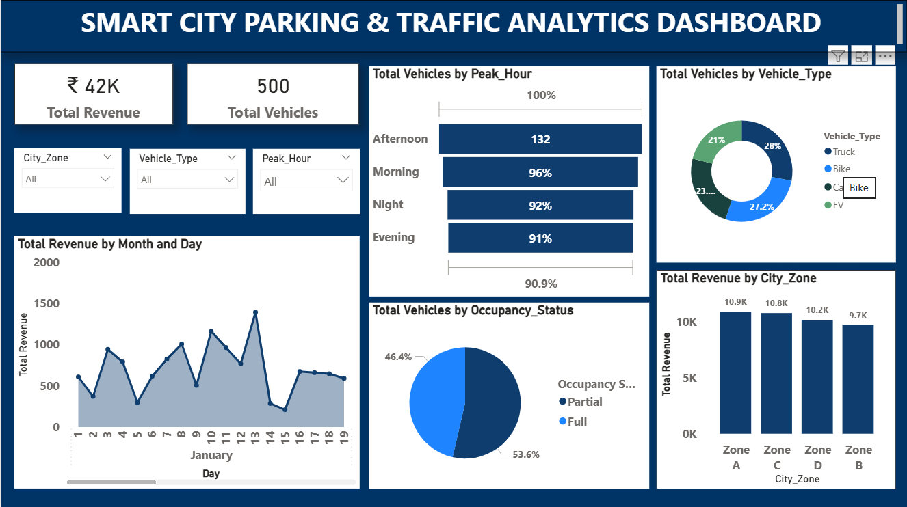

# Smart City Parking & Traffic Analytics

## Project Overview

This project analyzes smart city parking and traffic data using Microsoft Power BI to understand parking revenue, vehicle distribution, parking occupancy, and traffic congestion patterns.

The dashboard provides insights that can support data-driven decisions for improving parking management and urban traffic planning.

## Objectives

* Analyze total revenue generated from parking.
* Study vehicle distribution by type and peak hours.
* Evaluate parking occupancy and congestion levels.
* Compare revenue performance across city zones.
* Identify opportunities to improve traffic and parking management.

## Tools and Technologies

| Tool / Technology               | Purpose                                       |
| ------------------------------- | --------------------------------------------- |
| Microsoft Excel                 | Data cleaning and preparation                 |
| Power Query                     | Data transformation and preparation           |
| DAX (Data Analysis Expressions) | Creating measures and performing calculations |
| Microsoft Power BI              | Dashboard development and data visualization  |

## Project Workflow

1. **Data Cleaning:** Used Microsoft Excel to clean and prepare the dataset.
2. **Data Transformation:** Applied Power Query to transform and organize the data for analysis.
3. **Data Analysis:** Examined parking revenue, vehicle distribution, occupancy, and traffic congestion patterns.
4. **DAX Calculations:** Created DAX measures to calculate relevant metrics and support dashboard analysis.
5. **Dashboard Development:** Built interactive Power BI visualizations with filters for city zones, vehicle types, and peak hours.
6. **Insight Generation:** Identified traffic and parking patterns and developed recommendations for improving parking management.

## Dashboard Features

* City zone filtering
* Vehicle type filtering
* Peak-hour analysis
* Parking revenue analysis
* Vehicle count analysis
* Parking occupancy and congestion evaluation

## Key Insights

* Peak hours significantly affect vehicle volume.
* Some zones generate higher parking revenue than others.
* Cars and bikes dominate vehicle distribution.
* Higher congestion corresponds with lower average vehicle speed.

## Recommendations

* Increase parking capacity in high-demand zones.
* Consider EV parking infrastructure.
* Evaluate dynamic pricing during peak hours.
* Improve traffic flow in highly congested zones.
* Monitor key performance indicators regularly.

## Repository Structure

Smart-City-Parking-Traffic-Analytics/
│
├── README.md
│
├── dashboard/
│   └── smart_city_traffic_and_parking_analytics.pbix
│
├── dataset/
│   └── smart_city_dataset.csv
│
├── presentation/
│   └── smart_city_traffic_and_parking_analytics.pptx
│
└── screenshot/
    ├── smart_city_dashboard.png
    

## Dashboard Preview

## How to View the Project

1. Open the screenshots to preview the dashboard.
2. Open the PowerPoint presentation to review the project overview and findings.
3. Download the `.pbix` file and open it in Power BI Desktop to explore the report.

## Author

Muhammed Sinan T A
